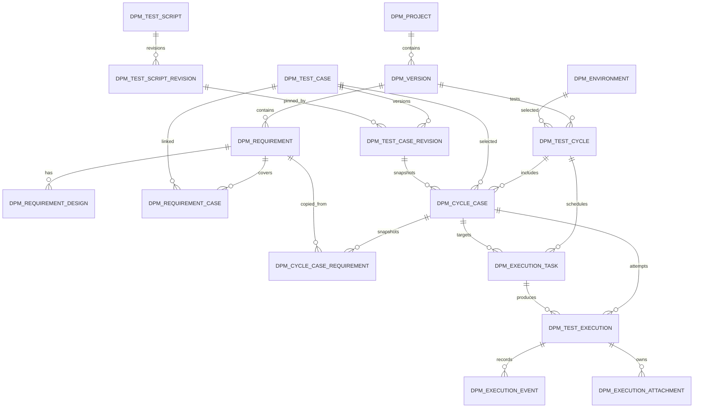

# 数据库设计（当前结构 V1.3.0）

## 1. 设计目标

数据库支撑项目、版本、需求、详细设计、测试用例、脚本、测试环境、测试轮次、执行任务及执行证据的全流程追溯。
当前数据库使用 MySQL 5.7.44、InnoDB、utf8mb4。

## 2. 已确认的核心规则

1. 一个软件项目可以有多个版本；一个版本包含多条需求。
2. 一个版本可以建立多个测试轮次；每轮只能绑定一个测试环境。
3. 环境编码由数据配置，不在业务代码中写死；当前预置 LOCAL、TEST3、PRE、PROD。
4. 一个测试轮次可以包含多条测试用例；同一轮次内同一用例只加入一次。
5. 测试用例可以关联多个需求；同一需求也可以被多个用例覆盖。
6. 创建轮次或向计划中的轮次增加用例时，固定当时的用例修订、需求内容、需求覆盖类型和最新详细设计修订。
7. 创建或修改计划中的轮次时，固定当时的环境配置快照；轮次开始后锁定环境、代码基线和用例清单。
8. 固定脚本保存不可变修订；测试用例修订绑定具体脚本修订，避免脚本后续修改改变历史执行依据。
9. 同一轮次用例允许多次执行；每次尝试单独保存结果、过程事件和检查点，执行任务支持整轮父子任务、单用例任务及幂等创建。
10. ChatGPT 可读取轮次快照并通过本地 API 登记执行过程；遇到登录、授权、验证码或页面确认等情况，任务进入 WAITING_HUMAN，人工确认后继续。
11. 固定脚本 Runner、浏览器自动化、附件上传和报告生成尚未实现；当前不执行用户提供的任意脚本源码。

## 3. 总体实体关系

说明：环境快照保存在 dpm_test_cycle.environment_snapshot JSON 字段中；需求和详细设计快照保存在 dpm_cycle_case_requirement 中，不额外建立环境快照表。

## 4. 数据表清单

当前共 18 张表（包含数据库版本记录表）。

| 表名 | 用途 |
|---|---|
| dpm_schema_version | 数据库结构版本记录 |
| dpm_project | 软件项目/代码仓库 |
| dpm_version | 软件版本 |
| dpm_environment | 可配置测试环境 |
| dpm_requirement | 版本需求 |
| dpm_requirement_design | 需求详细设计及修订历史 |
| dpm_test_case | 测试用例主表 |
| dpm_test_case_revision | 不可变的测试用例内容修订 |
| dpm_requirement_case | 需求与测试用例的当前覆盖关系 |
| dpm_test_script | 固定脚本主表及当前修订指针 |
| dpm_test_script_revision | 固定脚本的不可变修订历史 |
| dpm_test_cycle | 测试轮次及环境快照 |
| dpm_cycle_case | 轮次内用例清单及用例快照 |
| dpm_cycle_case_requirement | 轮次内需求及详细设计快照 |
| dpm_execution_task | 整轮父任务、单用例任务、状态及断点信息 |
| dpm_test_execution | 每次实际执行尝试、结果、快照和检查点 |
| dpm_execution_event | 执行步骤、断言、人工介入和恢复事件 |
| dpm_execution_attachment | 截图、日志、报告等附件元数据（上传流程待实现） |

## 5. 核心表关系和设计说明

### 5.1 项目、版本和需求

- dpm_project 是顶层项目，保存项目编码、名称、代码仓库地址和主分支。
- dpm_version 通过 project_id 归属项目；版本号在同一项目内唯一。
- dpm_requirement 通过 version_id 归属版本；需求编号在同一版本内唯一。
- 项目层用于支持同时管理多个软件项目。

### 5.2 需求详细设计

- dpm_requirement_design 通过 requirement_id 关联需求。
- revision_no 在同一需求内递增且唯一，设计内容使用 Markdown。
- 设计采用追加修订模式；创建新修订不覆盖旧修订。
- 测试轮次取创建该轮次用例快照时的最新设计修订（按 revision_no 倒序取第一条）；没有设计时 design_snapshot 为空。

### 5.3 测试用例与脚本

- dpm_test_case 保存用例编号、标题、状态和当前修订号。
- dpm_test_case_revision 保存前置条件、步骤 JSON、预期结果、类型、优先级、执行方式、脚本/AI 配置及测试数据。
- dpm_requirement_case 保存用例与需求的当前多对多覆盖关系。
- dpm_test_script 保存脚本编号、名称、启停状态及当前修订指针。
- dpm_test_script_revision 保存脚本版本、语言、运行时、来源、源码/受控相对路径、入口和参数 JSON；修订记录不可覆盖。
- dpm_test_case_revision 的 script_id 和 script_revision_id 用于绑定脚本主记录及具体脚本修订。
- 脚本语言目前允许 NODE、PYTHON、JAVA、HTTP；来源类型为 INLINE 或 FILE。
- FILE 来源当前只校验并保存安全相对路径字符串（拒绝绝对路径、空路径段、`.`、`..` 等）；HTTP/NODE Runner v1 只支持 INLINE，Python/Java 暂不执行 FILE。未来启用 FILE 执行时，必须在受控脚本根目录下解析规范化路径，并验证最终路径仍位于该目录内。
- 当前脚本模块提供脚本登记、编辑、启停和修订历史查询；固定脚本执行已支持 HTTP 只读 DSL 和 NODE QuickJS WASM 受限 JavaScript。Python/Java 执行器尚未实现。

### 5.4 测试环境

dpm_environment 保存环境编码、名称、类型、页面地址、API 地址、认证方式、凭据引用、非敏感配置 JSON、启停状态和排序。

- 当前预置 LOCAL、TEST3、PRE、PROD 四条环境记录，地址和认证配置由环境管理页面维护。
- auth_type 支持 NONE、BEARER、BASIC、COOKIE、API_KEY、CUSTOM。
- credential_ref 只保存本机凭据配置的引用标识，不保存密码、Token、Cookie 或密钥本身。
- config_json 仅保存非敏感参数；服务端递归检查 JSON 字段名，拦截 password、token、secret、cookie、authorization、apikey、credential、privatekey、clientsecret 等敏感字段名。配置值也不得夹带秘密信息。
- 环境可以停用；停用环境不能用于新建或修改轮次。当前没有环境物理删除接口。

### 5.5 测试轮次与环境快照

dpm_test_cycle 是版本下的测试轮次，主要字段：

- version_id：所属版本。
- cycle_no：版本内轮次序号，与 version_id 组成唯一约束。
- environment_id：所选环境 ID。
- environment_snapshot：创建或修改轮次时固定保存的环境信息 JSON。
- cycle_stage：LOCAL_DEV、INTEGRATION_TEST、REGRESSION、PRE_RELEASE、PRODUCTION。
- code_version、git_branch、git_commit、build_no：记录本轮实际测试的代码基线。
- scope_json：可选的测试范围 JSON 对象。
- status：PLANNED、RUNNING、COMPLETED、ABORTED。

环境快照包含环境 ID、编码、名称、类型、页面地址、API 地址、认证类型、凭据引用和非敏感 config_json。快照保存凭据引用，不复制凭据内容。

轮次处于 PLANNED 时允许修改配置、增加或移除用例；开始测试前必须至少包含一条用例。开始后状态变为 RUNNING，环境、代码基线和用例清单锁定。PLANNED 或 RUNNING 状态允许终止，终止后状态为 ABORTED。COMPLETED 为后续执行流程预留，当前尚无执行完成接口。

### 5.6 轮次用例及需求快照

- dpm_cycle_case 表示某轮测试中选中的一条用例。
- 创建或增加用例时，保存 test_case_revision_id、case_snapshot、execution_mode 和 sequence_no。
- case_snapshot 固定用例编号、名称、修订号、前置条件、步骤、预期结果、执行方式、脚本修订引用、AI 指令及测试数据。
- dpm_cycle_case_requirement 保存该用例在当前版本下关联的需求快照、coverage_type 和详细设计快照。
- requirement_snapshot 保存需求编号、标题、类型、正文、状态、优先级、负责人、项目和版本信息。
- design_snapshot 保存当时最新设计修订的 ID、修订号、类型、标题、正文、状态、作者和创建时间；无设计时为空。
- 后续编辑用例、需求、详细设计或环境，不改变已经保存的轮次快照。
- 只有 PLANNED 轮次允许增删用例；移除操作按 cycle_id 和 cycle_case_id 双重限定。

### 5.7 执行任务、人工介入和断点恢复

- dpm_execution_task 表示整轮父任务或单用例任务；整轮父任务通过 parent_task_id 关联子任务。
- task_type 区分 EXECUTE_CYCLE、EXECUTE_CASE；task_status 区分 PENDING、RUNNING、WAITING_HUMAN、RECOVERY_REQUIRED、COMPLETED、FAILED、CANCELLED。
- idempotency_key 与 cycle_id 唯一约束，避免网络重试重复创建任务；lease_owner、lease_token_hash、lease_expires_at 为独立 Runner 领取租约预留。
- dpm_test_execution 表示某条轮次用例的一次执行尝试，attempt_no 区分多次尝试；checkpoint_json 保存步骤级检查点。
- execution_status 区分 QUEUED、RUNNING、WAITING_HUMAN、INTERRUPTED、COMPLETED、CANCELLED；result 区分 PASS、FAIL、BLOCKED、SKIPPED。
- human_intervention_required、human_intervention_status 和 human_intervention_note 记录人工介入要求和决定。
- dpm_execution_event 保存步骤、断言、日志、检查点、人工介入和中断恢复事件；event_key 与 execution_id 唯一约束保证事件幂等。
- dpm_execution_attachment 保存截图、日志、请求响应和报告的文件元数据；执行证据附件上传/下载已实现，文件存放于项目 data/uploads/executions 目录，数据库仅保存相对路径、原文件名、MIME、大小和 SHA-256。

当前已实现执行任务创建、分页/详情、MANUAL/CHATGPT 开始、事件和检查点登记、结果提交、人工介入、取消和显式恢复 API，以及对应的执行任务页面。ChatGPT 本身通过 T14s Tunnel 访问本地 API；应用不直接调用 OpenAI API。固定 HTTP/Node Runner 和执行证据附件手动上传/下载已实现；浏览器自动化、自动截图/请求响应采集、Python/Java Runner 和测试报告生成仍未实现。

## 6. 状态约定

| 对象 | 状态/枚举 |
|---|---|
| 项目 | ACTIVE、INACTIVE |
| 版本 | PLANNING、DEVELOPING、TESTING、RELEASED、ARCHIVED |
| 需求 | DRAFT、CONFIRMED、DEVELOPING、COMPLETED、CANCELLED |
| 详细设计 | DRAFT、IN_REVIEW、APPROVED、REJECTED、SUPERSEDED |
| 测试用例 | ACTIVE、INACTIVE |
| 执行方式 | MANUAL、SCRIPT、AI |
| 脚本语言 | NODE、PYTHON、JAVA、HTTP |
| 脚本来源 | INLINE、FILE |
| 测试轮次 | PLANNED、RUNNING、COMPLETED、ABORTED |
| 轮次用例执行状态 | PENDING、RUNNING、WAITING_HUMAN、RECOVERY_REQUIRED、COMPLETED、CANCELLED |
| 执行任务 | PENDING、RUNNING、WAITING_HUMAN、RECOVERY_REQUIRED、COMPLETED、FAILED、CANCELLED |
| 执行尝试 | QUEUED、RUNNING、WAITING_HUMAN、INTERRUPTED、COMPLETED、CANCELLED |
| 执行结果 | PASS、FAIL、BLOCKED、SKIPPED |
| 人工介入 | REQUIRED、WAITING、CONFIRMED、REJECTED、NOT_REQUIRED |

状态字段使用 VARCHAR 保存，后端服务负责校验允许值。

## 7. 数据保留与安全

1. 版本、需求、测试用例、脚本修订和执行历史不做级联物理删除。
2. 项目、版本、需求、用例、轮次和执行证据等主数据关联采用 RESTRICT，避免删除父记录导致历史测试证据丢失；仅对允许失去可选引用的字段（如脚本修订引用、可选执行任务引用）使用 SET NULL。
3. 环境认证信息只保存 credential_ref；不要把密码、Token、Cookie 或密钥写入 config_json。
4. 脚本源码目前只登记和保存，不会由 Web 应用直接执行；后续 Runner 必须增加执行目录隔离、命令白名单、超时和权限边界。
5. 执行附件计划保存到本机 data/uploads，数据库保存相对路径、大小、类型和 SHA-256。
6. 生产环境默认禁止自动化写操作；执行前必须设置环境级安全策略和人工确认门槛。
7. 当前首版未设计多用户权限体系，created_by 等字段先记录操作者标识。

## 8. 数据库迁移历史与当前验证

| 版本 | 变更 | 结构结果 |
|---|---|---|
| V1.0.0 | 初始化项目、版本、环境、需求、用例、脚本主表、轮次及执行预留表 | 16 张表 |
| V1.1.0 | 新增脚本修订历史；为脚本主表增加当前修订指针；为用例修订增加 script_revision_id，并回填已有脚本的 V1 修订 | 17 张表 |
| V1.2.0 | 为测试轮次增加 environment_snapshot；新增轮次用例的需求/详细设计快照表 | 18 张表 |
| V1.3.0 | 为执行任务增加父子关系、幂等键、Runner 租约、取消请求字段；为执行尝试增加 checkpoint_json；为执行事件增加 event_key 和唯一约束 | 18 张表（ALTER，无新增表） |

- 初始化脚本：database/migrations/V1.0.0__initial_schema.sql
- 后续迁移：database/migrations/V1.1.0__script_revision_history.sql、database/migrations/V1.2.0__cycle_environment_and_requirement_snapshots.sql、database/migrations/V1.3.0__execution_task_lifecycle.sql
- 数据库：dev_process_manager
- 当前结构版本：1.3.0
- 当前环境初始化记录：LOCAL、TEST3、PRE、PROD 四条。
- 2026-11-09 已通过本机 MySQL 5.7.44 查询确认：schema_version 包含 1.0.0、1.1.0、1.2.0、1.3.0，information_schema.tables 统计仍为 18 张表。
- 迁移前备份：data/backup/dev_process_manager_before_v1.3.0_20261109_170049.sql（mysqldump，18 张表）。

V1.2.0 对已有轮次新增的 environment_snapshot 默认为 NULL，不会自动补写历史环境快照；旧轮次列表在快照为空时回退显示当前关联环境名称。新建或编辑的计划中轮次会写入快照。

V1.3.0 仅 ALTER 已有执行表，不删除或重建数据；父子任务外键引用 dpm_execution_task.id，幂等键允许 NULL 以兼容历史记录，事件幂等键也允许 NULL 以兼容历史事件。

执行迁移前应备份目标数据库。迁移脚本按版本顺序执行；已应用的版本不可重复执行。
